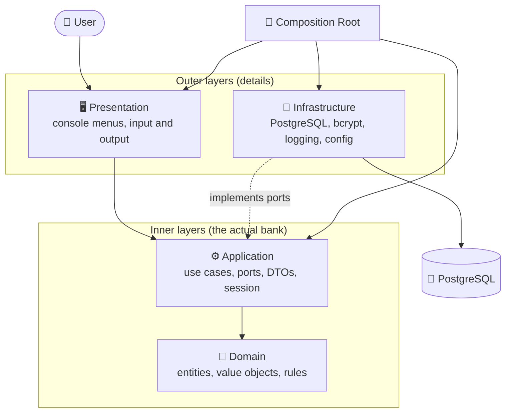
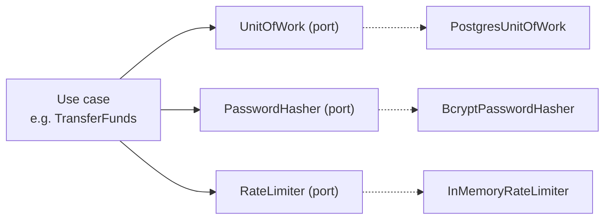
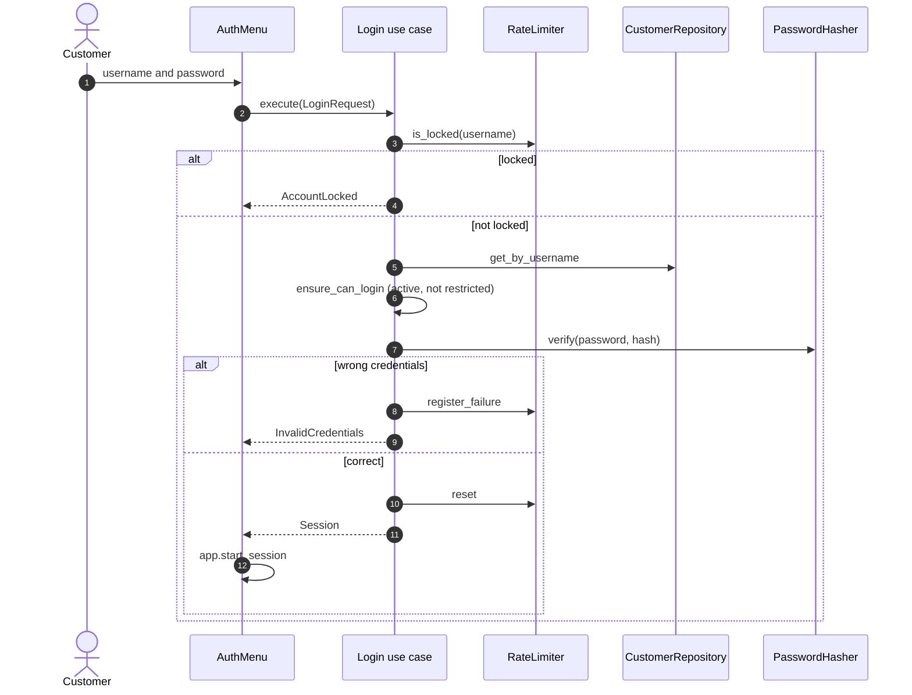
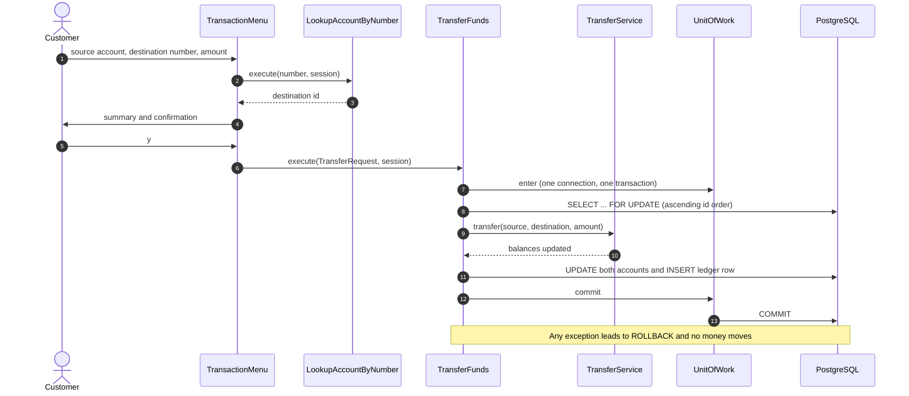
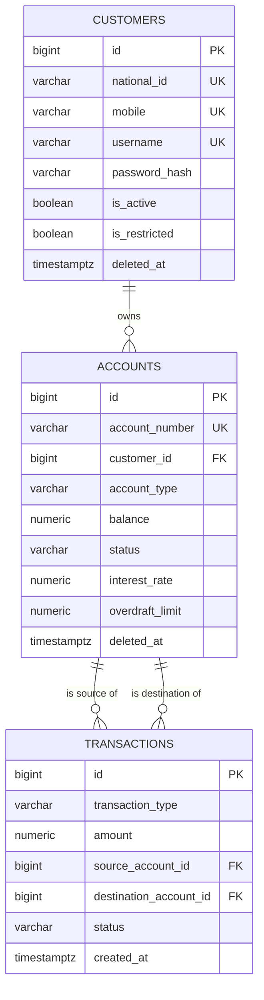

<div align="center">

# 🏦 Banking System

### A modular, test-driven console banking application built with **Python** and **PostgreSQL**

Customers, accounts, deposits, withdrawals and transfers, with a **Clean Architecture** that keeps business rules completely independent from the database, the console and every third-party library.

<p>
  
  
  
  
  
</p>

[✨ Features](#-features) •
[🎬 Demo](#-demo) •
[🏗️ Architecture](#️-architecture) •
[🧠 Code Walkthrough](#-code-walkthrough) •
[🚀 Getting Started](#-getting-started) •
[🧪 Testing](#-testing)

</div>

---

## 📖 Table of Contents

1. [✨ Features](#-features)
2. [🎬 Demo](#-demo)
3. [🏗️ Architecture](#️-architecture)
4. [📂 Project Structure](#-project-structure)
5. [🧠 Code Walkthrough](#-code-walkthrough)
6. [🔄 Key Flows](#-key-flows)
7. [🗄️ Database Schema](#️-database-schema)
8. [🔐 Security Model](#-security-model)
9. [🚀 Getting Started](#-getting-started)
10. [⚙️ Configuration](#️-configuration)
11. [🧪 Testing](#-testing)
12. [🧩 Design Decisions](#-design-decisions)
13. [🚧 Scope and Roadmap](#-scope-and-roadmap)
14. [🤝 Contributing](#-contributing)
15. [📄 License](#-license)

---

## ✨ Features

| | Capability | Details |
|---|---|---|
| 👤 | **Customer registration** | Validates national ID, mobile number, e-mail and password policy before anything is stored |
| 🔑 | **Login / logout** | bcrypt verification, temporary lock after repeated failures, sessions that really expire on logout |
| 🏧 | **Three account types** | 💰 Savings, 🧾 Checking (with overdraft limit), 📅 Term Deposit |
| ➕➖ | **Deposit and withdraw** | Row-level locking serializes concurrent money operations; each withdrawal applies the account's balance and overdraft rules to the locked row |
| 🔁 | **Atomic transfers** | Debit, credit and ledger entry are committed together or rolled back together |
| 📜 | **History and search** | Filter by transaction type and date range; filtering runs in SQL, not in Python |
| 🛡️ | **Ownership checks** | Customer-facing account and transaction actions verify ownership; administrative actions are not exposed in the console |
| 🗑️ | **Soft delete** | Deleting a customer deactivates their accounts and keeps every historical transaction |
| 🌍 | **Persian and Arabic digits** | `۱۲۳` and `١٢٣` are accepted anywhere a number is expected |
| 🧼 | **Safe logging** | Passwords, hashes and national IDs are masked automatically |

---

## 🎬 Demo

A representative session looks like this (menus and messages are in English):

```text
==============================
  Banking System
==============================

--- Main Menu ---
  1. Register
  2. Login
  3. Exit
Select an option: 2

==============================
  Login
==============================
Username: ali
Password:
[OK] Welcome, ali!

--- Customer Menu ---
  1. Customer Profile
  2. My Accounts
  3. Create Account
  4. Deposit
  5. Withdraw
  6. Transfer
  7. Transaction History
  8. Search Transactions
  9. Change Password
  10. Logout
Select an option: 2

==============================
  My Accounts
==============================
# | Account Number | Type    | Balance | Status
--+----------------+---------+---------+-------
1 | 1482915034417012 | SAVINGS | 150.00  | ACTIVE

Select an option: 6
# | Account Number | Type    | Balance | Status
--+----------------+---------+---------+-------
1 | 1482915034417012 | SAVINGS | 150.00  | ACTIVE
Transfer from which account? (0 to cancel): 1
Destination account number: 1731904552812048
Amount: 30
  From   : 1482915034417012
  To     : 1731904552812048
  Amount : 30
Confirm transfer? (y/n): y
[OK] Transfer completed (transaction #12).
[INFO] New balance of 1482915034417012: 120.00
```

---

## 🏗️ Architecture

The project follows **Clean Architecture**. Source-code dependencies only ever point **inwards**: the domain knows nothing about anything else, and the database is just a plug-in.



### 📏 The dependency rule

| Layer | May import | Must never import |
|---|---|---|
| 💎 **Domain** | Python standard library only | `psycopg`, `bcrypt`, `dotenv`, anything from the other layers |
| ⚙️ **Application** | Domain | Infrastructure, Presentation, any concrete library |
| 🔌 **Infrastructure** | Application ports and Domain | Presentation |
| 🖥️ **Presentation** | Application (use cases, DTOs) | SQL, repositories, business rules |

> 💡 **Why this matters:** ports isolate application logic from concrete infrastructure, while presentation calls use cases rather than repositories directly. Replacing an adapter can therefore leave the relevant business rules unchanged, although the new adapter and its integration tests still need to be implemented.

### 🔌 Ports and adapters

Use cases never talk to PostgreSQL directly. They depend on **ports** (abstract interfaces) that the infrastructure layer implements:



---

## 📂 Project Structure

```text
.
├── 🗄️ database/migrations/        SQL schema, applied in numeric order
├── 🛠️ scripts/migrate.py          Runs every migration file
├── 📦 src/banking/
│   ├── 💎 domain/                 The business rules
│   │   ├── enums/                 AccountType, AccountStatus, TransactionType, ...
│   │   ├── exceptions/            One meaningful exception per business failure
│   │   ├── value_objects/         Money, NationalId, PhoneNumber, Email, Password, AccountNumber
│   │   ├── entities/              Customer, Account, Transaction
│   │   └── services/              TransferService, InterestCalculator
│   ├── ⚙️ application/            Orchestration of the business rules
│   │   ├── context/               Session and ApplicationContext
│   │   ├── ports/                 Abstract interfaces implemented by infrastructure
│   │   ├── dto/                   Plain request/response data objects
│   │   └── use_cases/             auth, customer, account, transaction
│   ├── 🔌 infrastructure/         Real-world implementations of the ports
│   │   ├── configuration/         .env / environment reader
│   │   ├── logging/               Rotating file log with secret masking
│   │   ├── database/              Connections, transactions, UnitOfWork
│   │   ├── repositories/          PostgreSQL repositories
│   │   ├── security/              bcrypt hasher, login rate limiter
│   │   ├── generators/            Account number generator
│   │   ├── notifications/         Console notification channel
│   │   └── bootstrap/             Composition root, wires everything together
│   ├── 🖥️ presentation/console/   Menus, input reader, output writer, error handler
│   ├── 🧰 shared/constants.py     UI constants
│   └── 🚪 main.py                 Entry point
└── 🧪 tests/
    ├── unit/                      Fast tests, no database needed
    └── integration/               Tests against a dedicated PostgreSQL test database
```

---

## 🧠 Code Walkthrough

This section explains **what every module is for** and **why it exists**.

### 💎 Domain layer

The heart of the system. Pure Python, no I/O, no frameworks.

#### 🏷️ Enums (`domain/enums/`)

| Enum | Values | Purpose |
|---|---|---|
| `AccountType` | `SAVINGS`, `CHECKING`, `TERM_DEPOSIT` | Which kind of account this is |
| `AccountStatus` | `ACTIVE`, `INACTIVE`, `DELETED` | Domain account states; persistence soft-deletes accounts with `deleted_at`, while the database status constraint allows `ACTIVE` and `INACTIVE` |
| `TransactionType` | `DEPOSIT`, `WITHDRAWAL`, `TRANSFER` | Kind of ledger entry |
| `TransactionStatus` | `PENDING`, `COMPLETED`, `FAILED` | Lifecycle of a transaction |

All enums extend `str`, so they are stored and compared as plain text without conversion code.

#### 🚨 Exceptions (`domain/exceptions/`)

Every business failure is its own class, all inheriting from `DomainException`. The presentation layer catches that one base class and shows the message, so no stack trace ever reaches the user.

| Group | Exceptions |
|---|---|
| Customer | `CustomerNotFound`, `DuplicateNationalId`, `DuplicateMobile`, `DuplicateUsername`, `CustomerInactive`, `CustomerRestricted` |
| Account | `AccountNotFound`, `AccountInactive`, `InvalidAccountOperation`, `InsufficientBalance` |
| Transaction | `InvalidAmount`, `SameAccountTransfer`, `TransactionFailed` |
| Auth | `InvalidCredentials`, `AuthenticationFailed`, `AccountLocked` |

#### 🧱 Value objects (`domain/value_objects/`)

Immutable, self-validating objects. **It is impossible to construct an invalid one**, so invalid data can never travel through the system.

| Value object | Guarantees |
|---|---|
| `Money` | Always a `Decimal` (never `float`), always rounded to 2 decimals to match `NUMERIC(15,2)` |
| `NationalId` | Exactly 10 digits |
| `PhoneNumber` | Iranian mobile format `09xxxxxxxxx` |
| `Email` | Structurally valid address |
| `Password` | Minimum length, upper and lower case, digit, optional special character in strict mode, at most 72 bytes (bcrypt limit). Only validates, never hashes |
| `AccountNumber` | Exactly 16 digits |
| `CustomerId` | Positive integer |

#### 🧑‍💼 Entities (`domain/entities/`)

| Entity | Responsibility |
|---|---|
| `Customer` | Holds identity and status. Knows whether it may log in (`ensure_can_login`), can be activated, restricted, soft-deleted, and can replace its password hash |
| `Account` | **A single class for all three account types**, with type-specific terms (`interest_rate`, `overdraft_limit`, term dates) kept in `AccountTerms`. Owns the money rules: `deposit` and `withdraw` enforce a positive amount, an active account and sufficient funds (plus the overdraft limit for checking accounts) |
| `Transaction` | Validates itself on creation: positive amount, deposits need a destination, withdrawals need a source, transfers need two *different* accounts |

#### 🧮 Domain services (`domain/services/`)

| Service | Responsibility |
|---|---|
| `TransferService` | Pure transfer logic between two `Account` objects. It withdraws **before** it deposits, so a failed debit leaves the destination untouched |
| `InterestCalculator` | Computes interest from an account's balance and rate. The rate is injected, never hard-coded |

---

### ⚙️ Application layer

Orchestrates the domain to fulfil user goals. Contains **no SQL and no concrete library**.

#### 🪪 Context (`application/context/`)

| Class | Purpose |
|---|---|
| `Session` | Identity of the logged-in customer. `is_owner(customer_id)` is the single ownership check used across use cases. `invalidate()` kills the session on logout, and an invalidated session fails every ownership check afterwards |
| `ApplicationContext` | What the console receives: the registry of use cases plus the current session, with `start_session`, `end_session` and `require_session` |

#### 🔗 Ports (`application/ports/`)

| Port | Implemented by | Purpose |
|---|---|---|
| `CustomerRepository` | `PostgresCustomerRepository` | Persist and query customers |
| `AccountRepository` | `PostgresAccountRepository` | Persist and query accounts, with optional row locking |
| `TransactionRepository` | `PostgresTransactionRepository` | Append and query the ledger |
| `UnitOfWork` | `PostgresUnitOfWork` | One atomic database transaction across repositories |
| `PasswordHasher` | `BcryptPasswordHasher` | Hash and verify passwords |
| `RateLimiter` | `InMemoryRateLimiter` | Brute-force protection |
| `ConfigurationService` | `EnvironmentConfiguration` | Typed access to settings |
| `AccountNumberGenerator` | `RandomAccountNumberGenerator` | Produce new account numbers |
| `NotificationSender` | `ConsoleNotificationSender` | Deliver notifications |

#### 📦 DTOs (`application/dto/`)

Plain data objects used to cross the boundary. Requests carry raw strings in, views carry display-ready strings out. **Output DTOs never contain a password hash.**

#### 🎬 Use cases (`application/use_cases/`)

Each use case is one class with one `execute` method. Authorization is enforced **inside** the use case, never trusted from the console.

<details>
<summary><b>👤 Auth</b></summary>

| Use case | What it does |
|---|---|
| `RegisterCustomer` | Validates every field through value objects, checks that national ID, mobile and username are unused, hashes the password, stores the customer |
| `Login` | Checks the lock first, then credentials, then customer status. Unknown user and wrong password return the **same** message. Failures feed the rate limiter, success resets it |
| `Logout` | Invalidates the session |
| `ChangePassword` | Requires session ownership and the current password, validates the new password policy |

</details>

<details>
<summary><b>🧑‍💼 Customer</b></summary>

| Use case | What it does |
|---|---|
| `GetCustomer` | Returns a safe view of the profile, owner only |
| `SearchCustomers` | Keyword search across name, IDs, mobile and username |
| `ActivateCustomer` / `RestrictCustomer` | Change customer status |
| `DeleteCustomer` | Soft-deletes the customer and deactivates all their accounts **in one atomic transaction**. Historical transactions are never touched |

</details>

<details>
<summary><b>🏧 Account</b></summary>

| Use case | What it does |
|---|---|
| `CreateAccount` | Builds the right terms from configuration, rejects a negative opening balance, retries until it finds an unused account number |
| `ListMyAccounts` | Lists the session owner's accounts. The customer id always comes from the session |
| `LookupAccountByNumber` | Resolves a destination account number to an internal id and returns nothing else (no balance, no owner) |
| `GetAccount` / `GetBalance` | Owner-only reads |
| `ActivateAccount` / `DeactivateAccount` | Change account status |
| `ApplyInterest` | Calculates interest and deposits it |

</details>

<details>
<summary><b>💸 Transaction</b></summary>

| Use case | What it does |
|---|---|
| `Deposit` | Owner-only. Locks the account row, deposits, records a ledger entry, commits |
| `Withdraw` | Owner-only. Same pattern, with insufficient-funds protection |
| `TransferFunds` | Locks **both** accounts in ascending id order (prevents deadlocks), delegates to `TransferService`, writes one ledger entry, commits |
| `GetTransactionHistory` | Owner-only history of one account, newest first |
| `SearchTransactions` | Requires an owned account, then filters by type and date range in SQL |

</details>

---

### 🔌 Infrastructure layer

Concrete implementations. This is the **only** layer that imports `psycopg`, `bcrypt` and `dotenv`.

| Module | Role |
|---|---|
| 🧾 `configuration/environment_configuration.py` | Reads `.env` and environment variables, converts to `str`, `int`, `Decimal`, `bool`. Test overrides take priority |
| 📝 `logging/logging_config.py` | Rotating file log. A filter masks `password`, `password_hash`, `pin`, `national_id`, `token` and similar fields before they reach disk |
| 🔗 `database/connection.py` | `ConnectionFactory` opens connections (UTC, `READ COMMITTED`). Two `ConnectionProvider`s let one repository class work both standalone (`PerCallConnectionProvider`) and inside a unit of work (`BoundConnectionProvider`) |
| 🔄 `database/transaction_manager.py` | Owns commit, rollback and close for one connection |
| ⚛️ `database/postgres_unit_of_work.py` | The atomicity guarantee. Everything inside one `with` block is committed together, or rolled back on any error or a missing `commit()`. Nested use is rejected |
| 🗃️ `repositories/` | Map rows to entities. Hide soft-deleted rows, turn unique-constraint violations into `DuplicateNationalId` and friends, use `SELECT ... FOR UPDATE` when asked, always use parameterized SQL |
| 🔐 `security/bcrypt_password_hasher.py` | bcrypt with a fresh salt per hash and a configurable cost |
| 🚦 `security/in_memory_rate_limiter.py` | Sliding-window failure counter with a timed lock. The clock is injectable, so tests never need `sleep` |
| 🎲 `generators/account_number_generator.py` | Unpredictable 16-digit numbers from `secrets`. Final uniqueness is enforced by the database |
| 📣 `notifications/console_notification.py` | The one notification channel in this release |
| 🧩 `bootstrap/` | `container.py` holds the dependencies, `composition_root.py` is **the only place** where concrete classes are wired to ports, `application_factory.py` loads settings and logging then builds the app |

---

### 🖥️ Presentation layer

Everything the user sees. It contains **no SQL, no business rule and no money arithmetic**: it reads input, builds a DTO, calls a use case and prints the result.

| Module | Role |
|---|---|
| 🌳 `main_menu.py` | Register / Login / Exit. Always closes the session on the way out, even after `Ctrl+C` |
| 🔑 `auth_menu.py` | Registration (with edit-and-retry that remembers your answers), login, password change and the 10-item customer menu |
| 👤 `customer_menu.py` | Profile screen |
| 🏧 `account_menu.py` | Account list, account creation and the shared account picker |
| 💸 `transaction_menu.py` | Deposit, withdraw, transfer (with a confirmation step), history and search |
| ⌨️ `input_reader.py` | Safe typed input: required text, hidden passwords, menu choices, amounts with at most 2 decimals, optional `YYYY-MM-DD` dates, yes/no. Re-prompts instead of crashing |
| 🖨️ `output_writer.py` | Titles, numbered menus, `[OK]` / `[ERROR]` / `[INFO]` lines, aligned tables |
| 🛟 `error_handler.py` | Shows domain and validation errors as they are. Unexpected errors are logged with a traceback and hidden behind a generic message |
| 🎨 `view_formatters.py` | The only file that knows DTO field names. Turns views into table rows, shows `IN`/`OUT` direction and UTC dates |
| 🏭 `console_factory.py` | Builds the menu tree. Input, password and print functions are injectable, which is what makes whole console sessions testable |
| 🚧 `card_menu.py`, `atm_menu.py`, `admin_menu.py` | Placeholders for future features |

---

## 🔄 Key Flows

### 🔑 Login



### 💸 Transfer



---

## 🗄️ Database Schema



| Migration | Creates |
|---|---|
| `001_create_customers_table.sql` | `customers` with unique national ID, mobile and username |
| `002_update_at_trigger.sql` | The `updated_at` trigger function and customer trigger |
| `003_create_accounts_table.sql` | `accounts` with type and status checks and an index on `customer_id` |
| `004_create_transactions_table.sql` | `transactions` and indexes for history queries |
| `005_allow_withdrawal_transaction_type.sql` | Updates the transaction type constraint to allow `WITHDRAWAL` |

🧱 **Defence in depth:** business rules are checked in the domain and selected ledger invariants are also enforced by database constraints (positive transaction amounts, transfers between different accounts, deposits need a destination, withdrawals need a source). These constraints protect ledger shape; they do not replace account-level authorization or balance rules.

📒 **The ledger is append-only:** `transactions` has no `updated_at` and no `deleted_at`. Financial history is never edited or erased.

---

## 🔐 Security Model

| 🛡️ Threat | ✅ Mitigation |
|---|---|
| Stolen database | Passwords stored only as salted bcrypt hashes |
| Brute-force login | Sliding-window rate limiter with a timed lock |
| Username enumeration by message | Unknown user and wrong password produce the identical error |
| Accessing someone else's account | Customer-facing account and transaction use cases check session ownership; administrative use cases require a separate authorization boundary before exposure |
| Using a session after logout | Logout invalidates it, so all ownership checks fail |
| SQL injection | Every query is parameterized; `LIKE` wildcards typed by users are escaped |
| Race conditions on money | `SELECT ... FOR UPDATE`, with locks always taken in ascending id order |
| Half-finished transfers | Single `UnitOfWork` transaction, automatic rollback on error |
| Secrets in logs | Masking filter on the log handler |
| Password on screen | Entered through `getpass`, never echoed |
| Rounding surprises | `Decimal` everywhere, 2-decimal precision enforced |

**⚠️ Known limitations:** the rate limiter lives in memory, so it resets when the program restarts. Login on an unknown username skips bcrypt, which leaves a small timing difference. Destination-account lookup can be used to probe whether an account number exists. These are planned for the hardening phase.

---

## 🚀 Getting Started

### 📋 Prerequisites

- 🐍 Python **3.12** or newer
- 🐘 PostgreSQL
- 🌿 Git (optional)

### 🪟 Windows (PowerShell)

Run everything from the project root.

**1️⃣ Create the environment and install dependencies**

```powershell
py -3 -m venv .venv
.\.venv\Scripts\Activate.ps1
python -m pip install --upgrade pip
python -m pip install -r requirements.txt
```

> If PowerShell blocks the activation script, skip activation and call the interpreter directly: `.\.venv\Scripts\python.exe -m pip install -r requirements.txt`. Dependency declarations live in `pyproject.toml`; `requirements.txt` is a convenience installer for the project and its development tools.

**2️⃣ Create the database and a user**

```sql
CREATE USER banking_user WITH PASSWORD 'replace-with-a-strong-password';
CREATE DATABASE banking_system OWNER banking_user;
```

**3️⃣ Configure the environment**

```powershell
Copy-Item .env.example .env
```

Then edit `.env`:

```dotenv
DB_HOST=localhost
DB_PORT=5432
DB_NAME=banking_system
DB_USER=banking_user
DB_PASSWORD=your-local-database-password
```

> 🔒 `.env` is git-ignored. Never commit real credentials.

**4️⃣ Apply the migrations and run**

```powershell
python scripts\migrate.py
python -m banking.main
```

Migrations are **not** applied automatically, so run them before the first launch. The runner executes every SQL file on every invocation and does not keep a migration-version table. The current migration scripts are safe to apply repeatedly; future migrations should preserve that property. Back up existing data before applying schema changes.

### 🐧 macOS / Linux

```bash
python3 -m venv .venv
source .venv/bin/activate
python -m pip install -r requirements.txt
cp .env.example .env
python scripts/migrate.py
python -m banking.main
```

---

## ⚙️ Configuration

All settings live in `.env` (see `.env.example`).

| Variable | Purpose | Example |
|---|---|---|
| `DB_HOST`, `DB_PORT` | PostgreSQL address | `localhost`, `5432` |
| `DB_NAME`, `DB_USER`, `DB_PASSWORD` | Application connection | environment specific |
| `TEST_DB_NAME` | Dedicated test database, **must end with `_test`** | `banking_system_test` |
| `SAVINGS_INTEREST_RATE` | Interest rate of new savings accounts | `0.05` |
| `TERM_DEPOSIT_INTEREST_RATE` | Interest rate of new term deposits | `0.08` |
| `CHECKING_WITHDRAWAL_LIMIT` | Overdraft limit given to new checking accounts | `5000` |
| `TERM_DEPOSIT_EARLY_WITHDRAWAL_FEE` | Reserved for a future release | `0.02` |
| `PASSWORD_STRICT_MODE` | Require a special character in passwords | `false` |
| `LOGIN_MAX_FAILED_ATTEMPTS` | Failures before the lock | `5` |
| `LOGIN_RATE_LIMIT_WINDOW_SECONDS` | Window in which failures are counted | `60` |
| `LOGIN_LOCK_DURATION_SECONDS` | How long the lock lasts | `60` |
| `BCRYPT_ROUNDS` | bcrypt cost factor | `12` |
| `LOG_LEVEL`, `LOG_FILE_PATH` | Logging level and file | `INFO`, `logs/app.log` |

---

## 🧪 Testing

| 🧰 Kind | 📍 Location | 🎯 What it proves |
|---|---|---|
| ⚡ **Unit** | `tests/unit/` | Domain rules, use cases (with in-memory fakes), the rate limiter, the hasher, configuration, log masking and the console layer. No database needed |
| 🐘 **Integration** | `tests/integration/` | PostgreSQL repositories and use cases: persistence, transaction commit/rollback, soft delete, SQL filtering and money movement. The console-flow test uses fake use cases and does not require PostgreSQL |

### ▶️ Run the tests

```powershell
python -m pytest -q tests\unit
python -m pytest -q tests\integration
python -m pytest -q tests
```

### 🐘 The integration test database

Integration tests need their **own** database. Its name must end with `_test` and must differ from `DB_NAME`:

```dotenv
DB_NAME=banking_system
TEST_DB_NAME=banking_system_test
```

Create `banking_system_test` separately and make sure the `.env` user can access it. The session-scoped fixture applies every migration to this database. Tests use rollback or remove the specific records they create; the suite does not reset the whole database between tests. Keep this database dedicated to testing.

> ⛔ **Never point `TEST_DB_NAME` at a production or personal database.** Tests write records and some test cleanup issues targeted `DELETE` statements.

### 🎭 Console sessions as tests

Because input, password and print functions are injectable, console flows can be exercised without a terminal. The unit tests cover menu actions with fakes; `tests/integration/presentation/test_console_flow.py` checks the login/deposit/logout console flow using fake use cases.

### 🧹 Code quality

```powershell
ruff check src tests
mypy src
```

---

## 🧩 Design Decisions

<details>
<summary><b>❓ Why one <code>Account</code> class instead of one subclass per type?</b></summary>

The three account types differ only in a few numbers (interest rate, overdraft limit, term dates), not in behaviour. Keeping one class with an `AccountTerms` object avoids an inheritance tree and keeps repositories simple.

</details>

<details>
<summary><b>❓ Why <code>Decimal</code> and never <code>float</code>?</b></summary>

`0.1 + 0.2` is not `0.3` in binary floating point. `Money` wraps `Decimal` and rounds to 2 decimals, matching the `NUMERIC(15,2)` database column, so a value can never silently change between Python and PostgreSQL.

</details>

<details>
<summary><b>❓ Why a Unit of Work?</b></summary>

A transfer touches two accounts and the ledger. If the program fails halfway, money would vanish. The Unit of Work puts all three writes into one database transaction: everything or nothing.

</details>

<details>
<summary><b>❓ Why lock rows in ascending id order?</b></summary>

If Alice sends to Bob while Bob sends to Alice, each transaction could lock one account and wait forever for the other. Always locking the lower id first makes that situation impossible.

</details>

<details>
<summary><b>❓ Why do repositories take a connection provider?</b></summary>

So the same repository class works for one-off reads (own connection, auto-commit) and inside a Unit of Work (shared connection, controlled commit). It avoids writing every repository twice.

</details>

<details>
<summary><b>❓ Why does the console look accounts up by number?</b></summary>

Internal ids are database details that customers never see. People transfer to an **account number**, so a dedicated use case resolves it and returns only the minimum needed.

</details>

<details>
<summary><b>❓ Why is there a composition root?</b></summary>

`composition_root.py` is the single place that knows both a port and its concrete class. Everything else depends on abstractions. Tests build the same real wiring against the test database, so they exercise the real application.

</details>

---

## 🚧 Scope and Roadmap

**✅ Included in this release**

- Registration, login, logout and password change
- Accounts (savings, checking, term deposit), deposits, withdrawals, transfers
- History, search, soft delete, ownership enforcement, rate limiting

**🧪 Implemented and tested, but intentionally not reachable from the console yet**

`ActivateAccount`, `DeactivateAccount`, `ActivateCustomer`, `RestrictCustomer`, `SearchCustomers`, `DeleteCustomer`, `ApplyInterest`, `GetAccount`. They need an administrator concept and proper authorization before they are exposed.

**🛣️ Planned**

- 🔨 Hardening: constant-time login, use-case level audit logging, persistent rate limiting
- 💳 Cards and PIN management
- 🏧 ATM simulation
- 🧑‍💼 Administrator menu
- 📧 E-mail and SMS notifications
- 📅 Term deposit early-withdrawal fee

---

## 🤝 Contributing

1. 🐛 Open an issue to discuss a significant change first.
2. 🌿 Create a branch and keep the dependency rule intact: **domain imports nothing, application imports only domain**.
3. 🧪 Add or update tests next to your change.
4. ✅ Run `pytest`, `ruff check src tests` and `mypy src` before sending your changes.

---

## 📄 License

MIT License

<div align="center">

Made with 🐍 Python, 🐘 PostgreSQL and a lot of ☕

</div>
